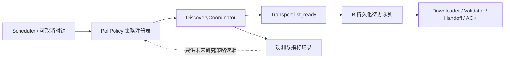

# Adaptive Archive Sync（AAS）v1.2 架构审查与增量补丁 PATCH-01

> **文件性质**：对《Adaptive Archive Sync（AAS）开发设计方案 v1.2》的**增量架构补丁**；不是重新设计，也不是替换 v1.2 全文。  
> **基准文件**：`Adaptive_Archive_Sync_v1.2_开发设计方案.md`（2026-10-22）。  
> **补丁版本**：`PATCH-01`；状态：**建议合入，包含必须修复项 P0**。  
> **范围**：单 A（Linux GPU 云端）、单 B（Windows/Linux 本地）、受限 SSH 控制与文件传输；不扩大成对象存储或多消费者系统。  
> **优先级**：本补丁与 v1.2 明确冲突的条款，以本补丁为准；未列为变更项的 v1.2 设计继续有效。  
> **最终判断**：**无需提出新的用户级架构问题**；完成本文 P0 修订后，可以冻结首版 MVP 设计并开始分阶段实现。

---

## 0. 本次需求变化与审查结论

### 0.1 本次明确变更

1. **本期不实现自适应轮询及在线学习**：相关算法仍处于研究阶段，不得让它阻塞可靠归档/传输功能上线。
2. **B 端默认采用固定时间间隔轮询**（`fixed_interval`），并把轮询器做成可替换的 `PollPolicy` 策略模式。
3. **v1.2 保持为方法与架构基准**：保留其中自适应算法的研究思路、评估指标与数据模型，未来作为候选方法与固定轮询基线做公平比较；目前不进入正式运行路径。
4. 其余已确认边界**不变**：A 全量验包成功、持久发布后才删除源图；B 验证并完成一次交付后 ACK，不再管理用户输出；A 仅凭有效 ACK 删除归档；异常容量只告警、不自动暂停生成器；应急逐图传输由 B 手动发起，风险保证低于正常通道。

### 0.2 总体审查结果

| 类别 | 判断 | 处理方式 |
|---|---|---|
| A/B 职责、SSH 方向、不可变归档、ACK | **可保留** | 无需改动核心边界 |
| 双重正常删除前置条件 | **可保留，但恢复证明需要补强** | P0-03、P0-04、P0-06 |
| B 输出允许用户自由修改 | **可保留，存在已接受的短暂交付不确定窗口** | P0-07 明确恢复规则 |
| `ready_event_id` 与 `seq` 分离 | **正确** | P0-05 补足分页/游标原子性 |
| 默认自适应轮询 | **不符合本次阶段目标** | P0-01、P0-02 替换成固定轮询策略 |
| A 临时审核密钥销毁后的 SOURCE_CLEANING 恢复 | **实际设计缺陷** | P0-03 必须修复 |
| 加密插件能自行宣称验包通过 | **验收边界偏弱** | P0-04 必须收紧 |
| 应急通道与正常领取之间的并发 | **原则正确，须明确锁作用域** | P1-02 补充约束 |
| 不保证云实例毁损、单副本物理失效 | **已由用户接受** | 保持非目标，不额外发问 |

**结论解释**：这里的“可以进入开发”是指逻辑契约与容错边界能够确定，并非代码已经验证。P0 属于设计定稿和实现验收的前置修订。

---

## 1. 补丁总索引及优先级

| ID | 优先级 | 对应 v1.2 | 需要修订的核心问题 |
|---|---|---|---|
| **P0-01** | 阻断 | §0/U6、§2、§8、§14.2、§15/M3 | 固定轮询成为唯一默认可运行策略；自适应留研究接口 |
| **P0-02** | 阻断 | §2、§5、§8、§15 | 策略只决定*发现时机*，发现与下载队列分离 |
| **P0-03** | 阻断 | §4.2–4.4、§12.1 | A 临时审核密钥销毁后，崩溃恢复仍须安全续删原图 |
| **P0-04** | 阻断 | §4.3、§9 | VerifyGate 的权威校验不可委托给可插拔 CryptoStrategy 的成功布尔值 |
| **P0-05** | 阻断 | §5.1、§8.3、§10、§12 | READY 增量游标、分页、持久待办必须一起保证无漏批 |
| **P0-06** | 阻断 | §4.4、§6.2、§11、§12 | 两类正常删除的身份/证据/崩溃恢复契约统一 |
| **P0-07** | 阻断 | §5.2–5.3、§12.2 | B 独立收据、用户可改文件与 `HANDOFF_UNCERTAIN` 的关系明确 |
| **P1-01** | 重要 | §8、§13、§16 | 成功空轮询与网络失败分开记账；明确固定轮询时钟语义 |
| **P1-02** | 重要 | §7 | 应急独占锁与普通领取按“单文件归属”隔离，限制会话范围 |
| **P1-03** | 重要 | §13、§14 | 有限空间的容量上限检测、告警，不加入自动删除未 ACK 包 |
| **P1-04** | 重要 | §9、§10 | 加密密钥、解密挑战、策略版本在协议中稳定绑定 |
| **P1-05** | 重要 | §15、§16 | 用例、可观测性、后续研究评估基线统一 |

---

## 2. P0-01：将固定间隔轮询做成策略模式（替换 v1.2 §8 的默认执行路径）

### 2.1 统一的职责边界

`PollPolicy` **只决定何时尝试下一次 READY 查询**；不负责 SSH 建连、列出批次、下载、ACK、删除，也不能直接修改 A/B 的状态库。外部业务流程固定为：



- **本期生产可用**：`fixed_interval`。
- **接口保留但不交付生产实现**：`adaptive_research`（v1.2 §8 的到达率估计、Gamma–Poisson 等研究算法）；不能仅凭配置就激活尚未实现或未验证的插件。
- **可选后续插件**：`long_poll`；不是本期默认，也无需在固定轮询开发时实现。
- **网络故障重试不属于 PollPolicy 的优化目标**，由独立的 `RetryPolicy` 或传输层错误恢复管理。

### 2.2 最小策略接口（建议 Python 3.11+）

```python
from dataclasses import dataclass
from typing import Protocol

@dataclass(frozen=True)
class DiscoveryObservation:
    # 仅代表一次完整、成功的 READY 查询；连接失败不构造此对象
    observed_ready_events: int
    newly_enqueued_batches: int
    queried_pages: int
    completed_at_monotonic: float

@dataclass(frozen=True)
class PollContext:
    now_monotonic: float
    has_pending_transfers: bool
    shutdown_requested: bool

class PollPolicy(Protocol):
    policy_name: str

    def validate_config(self) -> None: ...
    def observe(self, event: DiscoveryObservation) -> None: ...
    def next_delay_seconds(self, context: PollContext) -> float: ...
    def export_state(self) -> dict: ...
    def import_state(self, state: dict) -> None: ...

class FixedIntervalPoll:
    policy_name = "fixed_interval"

    def __init__(self, interval_seconds: float):
        if interval_seconds <= 0:
            raise ValueError("interval_seconds must be positive")
        self.interval_seconds = interval_seconds

    def validate_config(self) -> None: ...
    def observe(self, event: DiscoveryObservation) -> None:
        pass  # 只产生业务统计，不调整周期
    def next_delay_seconds(self, context: PollContext) -> float:
        return self.interval_seconds
    def export_state(self) -> dict:
        return {"schema_version": 1}
    def import_state(self, state: dict) -> None:
        pass
```

注：上面是**接口契约示例**，不要求在补丁阶段编写实现代码。`DiscoveryObservation` 可继续增加 A 的 `ready_at`、成功空观察暴露时长等字段，但不得把它们写死为本期调度必需依赖。

### 2.3 `fixed_interval` 的准确语义

- 启动 B 后，**立即进行一次发现**，不先睡眠一个周期。
- 一次完整成功扫描结束后，以 B 的**单调时钟（monotonic clock）**计算下次常规扫描：`next_due = scan_completed_mono + interval_seconds`。
- `interval_seconds` 是 **READY 发现查询之间的间隔**，**不是**相邻归档生产的预测间隔，也不是下载一个包的预计时间。
- B 的下载、解密、交付、ACK 在**独立的、有界 worker 队列**中进行，不得因传输一个 4GB 包就延后下次 READY 查询。
- 若本轮发现新 READY，允许**一次有界的立即复查**以追赶同轮新包；后续回到固定周期。严禁“只要队列不空就 0 延迟循环查询”造成 SSH 空转。
- 同一时刻最多一条发现扫描进行：`single_flight_discovery = true`；若扫描超期，不启动重叠扫描，记录一次 `missed_deadline`，结束后重置下一轮期限。
- 网络/认证失败时：按独立的指数退避或需要人工修复的错误分类处理；不得记为“成功扫描，发现 0 个包”，也不更新任何到达率统计。
- 定时完整对账独立于策略，不能因为换策略而停止；对账也应使用单飞锁避免与本轮分页查询冲突。

### 2.4 配置的初始值如何解释

建议首版 `interval_seconds = 300`（5 分钟）**仅是可改的默认值**。例如生产先验为 6 包/小时，平均每 10 分钟出现一个包，不意味着 B 也必须每 10 分钟查询一次；查询周期取决于可接受的发现延迟与 SSH 请求开销。

在事件到达与定时查询相位近似独立且 B 始终在线的**理想情况**下，固定周期 `T` 的平均发现等待约为 `T/2`、P95 约为 `0.95T`；真实网络失败、长时间不可用和本地负载可使时延更大，因此不能把该估计写成保证。

- 保留 `expected_archives_per_hour`：**仅作为统计标签、容量估算与未来自适应研究的先验**，本期不改变固定轮询周期。
- 禁止同时指定两个有歧义的调度主参数：**当前有效时间由 `interval_seconds` 独立决定**。
- 如果未来采用 `adaptive_research`，才允许其读取 `expected_archives_per_hour` 估计下一次查询时间。

---

## 3. P0-02：发现与传输必须解耦

### 3.1 本期 B 端执行模型

```text
PollingTask（单实例）
  ├─ 每轮从 A 分页获取当前 READY/新 READY 事件
  ├─ 在 B SQLite 中幂等登记待传批次与游标
  ├─ 成功则按固定间隔安排下一轮；失败交给网络重试器
  └─ 发现新包时有界立即复查一次

TransferWorkers（默认 2 个，可配置）
  ├─ 从持久队列领取任务
  ├─ get_range 断点下载 → hash → 解密 → 解包 → 逐文件 hash
  ├─ 用户目录交付 → 内部独立 DELIVERED 收据
  └─ 发送 ACK；网络失败保留 ACK_PENDING

Reconciler（独立定时任务）
  └─ 全量 READY + ledger 对账，补录遗漏任务，不修改历史 DELIVERED
```

这样满足“如果 A 有多个包，B 就把可用包**全部发现并排队**”：不等于无限并行下载，也不要求这一轮必须全部传输完成才允许下一次查询。

### 3.2 参考执行伪代码

```python
async def discovery_loop():
    next_scan_due = monotonic()  # 启动立即查；首次失败也走正常重试
    while running:
        await sleep_until_monotonic(next_scan_due)  # 可被停止事件唤醒
        try:
            observation = await discovery.scan_all_pages_and_enqueue()
            if observation.newly_enqueued_batches > 0:
                await discovery.immediate_catchup_once()  # 最多一次；仍保证持久落队
        except RetriableTransportError:
            next_scan_due = monotonic() + retry_backoff.next_delay()
            continue
        except NonRetriableAuthOrProtocolError:
            raise_need_operator_attention()
            break

        retry_backoff.reset()
        poll_policy.observe(observation)
        next_scan_due = monotonic() + poll_policy.next_delay_seconds(context())
```

**必须补充的约束**：`scan_all_pages_and_enqueue()` 处理的不只是内存队列。至少需要在 SQLite 中持久化待办；当 B 崩溃重启时，已发现但尚未下载或尚未 ACK 的包不能因为游标推进而丢失。

---

## 4. P0-03：修复 A 临时审核密钥与崩溃恢复冲突（本次最高优先级）

### 4.1 v1.2 中存在的真实漏洞

v1.2 §4.3 使用 **A 的一次性审核收件人私钥**，对最终 age 密文进行解密回读，随后销毁临时私钥；同一方案 §4.2、§12.1 又要求 A 在 `SOURCE_CLEANING` 崩溃重启后“核验已发布 bundle，再续删剩余原图”。

如果恢复步骤被实现为**重新解密整包逐图审核**，已销毁的私钥将使这个动作无法进行。此时已删除的部分 staging 原图也不足以重新生成完整包。**这不是参数问题，而是验证凭据生命周期与删除恢复协议冲突。**

### 4.2 修订方案：一次性完整验包 + 持久校验证书 + 重启后密文指纹复核

定义 A 内部 `VerificationCertificate`（可信内部工件，非 B 的 ACK）：

```json
{
  "schema_version": 1,
  "producer_id": "gpu-a-01",
  "batch_id": "<canonical-batch-id>",
  "result": "PASS",
  "final_payload_sha256": "<64-hex>",
  "payload_bytes": 123456789,
  "manifest_sha256": "<64-hex>",
  "source_snapshot_sha256": "<64-hex>",
  "files_index_sha256": "<64-hex>",
  "plaintext_archive_sha256": "<64-hex>",
  "verified_at": "<UTC ISO 8601>",
  "verifier_version": "aas-verifygate/1"
}
```

**顺序为硬约束**：

1. A 先完成原图领取，生成不可变的 `source_snapshot`；检查所有归档成员与源快照一一对应。
2. 构建归档及加密 payload；对**最终实际生成的密文文件**执行完整解密、tar 解析及逐文件 SHA-256 复核；核心 VerifyGate（不是加密插件）给出 `PASS`。
3. 将正式 manifest 的内容固定下来，计算 `manifest_sha256`；写入 `VerificationCertificate`，同时在 A 的状态库中绑定 `batch_id + final_payload_sha256 + manifest_sha256 + source_snapshot_sha256`。证书和状态记录**必须先持久化**，再允许删除任意原图。证书中不能包含审核私钥。
4. `bundle + manifest + certificate` 在同一批次目录内持久写入、`fsync` 后原子发布；A 的 DB 记录进入 `SOURCE_CLEANING`。完成上述步骤后才可销毁本次审核私钥。
5. `SOURCE_CLEANING` 每次启动或恢复时：**重新读取并计算已发布密文 payload 和 manifest 的 SHA-256**，比对已持久化证书及 DB 绑定值；全部一致即可证明这些字节与先前完整验包通过的工件相同，然后续删尚未删完的 staging 原图；**不要求重启后再次解密**。
6. 如果证书不存在、持久状态互相矛盾、bundle 或 manifest 指纹不匹配：**停止后续源图删除**，转人工隔离/故障状态并保留尚存原图；不得“为了完成 READY”跳过审核。

可信性假设：证书与状态库属于本机受限账户的可信持久状态，防止普通崩溃与意外损坏；这不是对拥有 A 根权限的恶意运营者的防篡改承诺。SHA-256 一致性对应的是**先前审核通过的精确字节内容**，不是“可在所有环境下永久解密”的保证。

### 4.3 状态机修订条款

在 v1.2 的 `VERIFYING → PUBLISHING → SOURCE_CLEANING → READY` 不变的前提下增加不变量：

> **进入 `SOURCE_CLEANING` 前，必须存在与已发布 payload、manifest 逐项匹配的持久化 PASS 校验证书。删除工作者每次启动/重启必须先核验该凭据及归档指纹。**

建议增加 `VERIFY_RECOVERY_BLOCKED` 或等价可诊断错误状态，供审计与人工处理。不得用简单的 `quarantined: true` 隐藏究竟是“证书缺失”还是“归档损坏”。

---

## 5. P0-04：CryptoStrategy 只负责密码学，核心 VerifyGate 独立承担可靠删除的判定

v1.2 的 `CryptoStrategy.audit_roundtrip(...) -> VerificationReport` 容易让开发者把“自定义插件报告 PASS”直接当作删除源图的充分条件，破坏策略模式下的安全边界。

**推荐替换接口**：

```python
class CryptoStrategy(Protocol):
    scheme: str
    version: int

    def validate_config(self, config) -> None: ...
    def selftest(self) -> None: ...
    def encrypt_stream(self, source, sink, context) -> dict: ...
    def decrypt_stream(self, source, sink, metadata, context) -> None: ...
    def make_audit_context(self, context) -> object: ...  # 可选能力

class VerifyGate:
    def verify_final_bundle(
        self, *, bundle_path, manifest, source_snapshot, decryptor
    ) -> VerificationCertificate: ...
```

- `CryptoStrategy` 可提供为本次审计准备的临时身份、配置及流式解密器，但**不决定是否可以删除**。
- `VerifyGate` 在可信公共模块里完成最终字节校验、归档结构检查、成员白名单、每张文件哈希与源快照对应、错误分类和校验证书持久化。
- 任一自定义加密策略不支持**从最终 bundle 解密回读**时，正常通道必须拒绝启动“自动删源图”功能（可明确报 `AUDIT_CAPABILITY_MISSING`）。
- A 的临时审核身份证明“最终 bundle 在 A 上可解密”；B 的主/备密钥是否仍可用，通过 `crypto-probe` 和实际 B 交付验证另行保障。**不要把临时审核通过误写成 B 一定能解密。**
- 自定义策略不能通过返回 `success=True` 越过 `VerifyGate`；即使策略 bug 或返回假成功，外层仍必须按可信源快照比对完整解密输出。

---

## 6. P0-05：READY 分页与事件游标的持久化一致性

v1.2 已区分 `seq` 与 `ready_event_id`，方向正确；但仍应明确**分页快照、队列入库、游标推进**的事务顺序。

### 6.1 服务器协议建议

`list-ready` 提供：

```text
list-ready --after-event-id E --page-size N [--snapshot-high H]
  → {producer_id, snapshot_high, items:[...], next_event_id, has_more}
```

- A 的 `ready_event_id` 每次进入 READY 都单调递增，包括必要的重开事件；B **不能**以 `seq` 代替它。
- 首次分页返回本次扫描的 `snapshot_high`，之后同轮请求带同一个边界，按 `(ready_event_id, batch_id)` 稳定排序，避免并发新批次造成翻页跳页。
- 此接口列举的是**当前 READY 的批次**，不是“完整历史事件日志”；账本 `ledger` 仍用于审计。已不处于 READY 的批次可以不在该列表，但每次**重新变成 READY**都必须获得新的事件 ID。
- B 定期执行**不依赖事件游标的全量 READY 对账**，补齐游标损坏、异常回滚或人工恢复造成的漏批。

### 6.2 B 必须保证：先持久化队列，再推进游标

每收到一页：

```text
BEGIN IMMEDIATE;
  UPSERT transfers(producer_id, batch_id, payload_sha256, ...)
    WHERE 本地状态尚非 DELIVERED/ACK_CONFIRMED；
  UPDATE discovery_cursor = 本页已安全登记的最后 event_id；
COMMIT;
```

- 如果在事务前崩溃：下一次**重取同页**。
- 如果在事务后崩溃：批次已在本地持久待办队列，重启可继续处理。
- 禁止“发现新包 → 仅放内存队列 → 先前进游标 → 再异步写 SQLite”，否则 B 崩溃会**永久跳过该 READY 事件**。
- 游标作用域为 `producer_id + consumer_id + protocol_epoch`；如果 A 的账本重建或实例替换但复用身份导致事件 ID 回退，必须报错并由人工确认身份，而不是静默跳过。
- `READY` 对应清单内容、bundle 指纹**不可变**；同一 `batch_id` 返回不同哈希，必须中止、隔离并报警，不能直接覆盖本地 `.part` 当作同一包。

**注意**：`UPSERT` 的确切 SQL 条件要基于允许的本地状态迁移实现，不能让一个旧 READY 响应把已交付批次回退到 `DISCOVERED`。

---

## 7. P0-06：两次正常删除共享一套可靠性契约

### 7.1 删除一：源图（`staging/`）

只允许 A 的 `SourceCleaner` 触发：

- 前提：存在**经校验且已持久发布**的完整 bundle + manifest + `VerificationCertificate(PASS)`；DB 处于 `SOURCE_CLEANING`。
- 目标：只按**持久领取清单中已分配给本批的 staging 相对路径**删除，不接受从远端传入的任意路径；拒绝软链接和路径逃逸；删除前确认文件身份没有变化。
- `unlink` 后同步目录元数据、更新删除进度记录；中途崩溃按清单重放，已不存在且有对应凭据的项按幂等已完成处理。
- 归档指纹与审核凭据不一致时**停止删除**；即使只剩一张源图也不得强行推进 READY。
- 只有**所有原图清理完成**，才在事务中置 `READY` 并分配新的 `ready_event_id`。

### 7.2 删除二：归档包（`ready/`）

只允许 A 的 `BundleCleaner` 触发：

- 前提：已持久接受授权 B 的匹配 ACK，且通过 CAS 从 `ACKED` 进入 `DELETING`；收到 SSH 下载成功、hash 相符或 `PREPARED` 收据都**不是**删除资格。
- 只定位 `ready/<canonical_batch_id>/`；再次确认所指包身份与 ACK 的 `payload_sha256` 一致；按固定文件白名单 unlink `bundle`、`manifest`、`verification_certificate` 等内部工件，清空目录后 `rmdir`。
- 中途崩溃允许续删：需保留**单独的持久 ACK/删除墓碑与原始 manifest 指纹**，不能因 manifest 已被删除就失去身份判据。
- `ACKED → DELETING` 后无需依赖 `reopen`；默认 `ack_grace_seconds=0` 保留，已明确不保证后续重新下载窗口。
- 永不删除未 ACK 的 READY；任何磁盘临界值不得绕过这条硬约束。

### 7.3 可恢复的“可靠删除”与安全擦除不是一回事

`unlink` 不调用回收站接口，满足“直接文件系统删除”，但**不等于** SSD 介质不可恢复擦除、云服务商快照已删除或规避平台审查。日志中应记录 `logical_delete_completed`，而不是 `secure_erased`。

---

## 8. P0-07：B 交付和自由修改的边界不变，但不可自动掩盖不确定交付

保留 v1.2 的 `PREPARED → output rename → DELIVERED receipt → ACK`。

- 交付收据放在 `B/state/receipts/`，**不放在用户 output 目录**；它证明**某时刻曾成功交付**，不负责保证用户当前仍保留图片。
- `DELIVERED` 收据须与本批身份、清单和哈希绑定，持久落盘后才能发 ACK；ACK 之前用户移动、删除或修改 output **不能自动撤销已持久形成的 DELIVERED**。
- `PREPARED` 后、`DELIVERED` 前崩溃：先利用尚在私有 staging 的内容和既定目标路径恢复；如果已完成 rename 但目标被用户移走或修改且无法验证历史事件，进入 `HANDOFF_UNCERTAIN`、保留证据、请求人工选择；**不自动发 ACK，也不自行重新交付制造重复**。
- 对 `HANDOFF_UNCERTAIN` 只开放带审计记录的运维解决命令；任何人工确认不应冒充程序已经自动证明的完整性验证。
- B 的 SQLite 可由内部收据重建；当用户清空输出时，不把历史 DELIVERED 回滚成待下载，不启动图库巡检或管理功能。

> **保留的限制**：用户可以在正式目录出现后立刻移动/修改图片，且 rename 与外部收据不是跨卷原子事务。因此极短的交付窗口仍可能需要人工判定。这是 v1.2 已接受的语义，不应在测试报告中虚称“任意用户操作下都能全自动 exactly-once 恢复”。

---

## 9. P1-01：固定轮询与故障重试的观测分离

应分别记录：

| 类型 | 是否算成功观测 | 是否重排固定周期 | 是否作为未来研究训练样本 |
|---|---|---|---|
| 成功扫描，0 个 READY | 是 | 是 | 是：计数 0 + 有效观测区间 |
| 成功扫描，N 个 READY | 是 | 是 | 是：以 A 端 READY 时间戳为准 |
| 网络超时/断网 | 否 | 由 RetryPolicy 决定重试 | 不得伪造为 0 包 |
| SSH 认证失败/协议版本不兼容 | 否 | 暂停连接并报错，待人工修复 | 否 |
| B 传输任务失败 | 不影响已成功的 READY 查询 | 不影响正常发现时钟 | 单独记录传输失败 |
| B 输出盘满 | 发现仍可记录，暂停下载/交付 | 可继续受限发现与告警 | 到达观察有效，交付时间不可作为纯网络耗时 |

固定周期从“**完整成功扫描结束时刻**”起算；不是从“上一张图下载完成”起算。使用单调时钟控制定时、使用 A 时间戳用于历史到达建模，避免系统时钟回拨导致无意的高频扫描。

---

## 10. P1-02：应急逐图传输维持简单，但必须隔离正常通道

- 保留 `B → SSH → aasctl emergency-stream`、A 逐图发长度帧、B 完成一张后 `OK(token)`、A 随即 `unlink` 的原始方案；**不引入 tar、不引入正常 seq、不要求复杂事务补偿**。
- 正常 BatchBuilder 与应急会话必须共享同一个 `input_claim_lock` 或等价原子领取操作；应急会话优先只碰 `input/` 中**尚未被领取的完整文件**，不碰 `staging/`、`ready/`。
- 优先将应急目标移入单独 `emergency_claim/` 固定文件身份，避免同名新文件覆盖；会话退出后，未确认的文件允许归还 `input/`。该通道允许重复传输/人工恢复，**不假装具备正常可靠删除保证**。
- `OK(token)` 至少意味着 B 已完整收到对应长度的文件，并能识别 `file_token`；如果愿意付出极小代价，建议 B 再做单文件 SHA-256 后才回复 OK，仍然不需要完整批次状态机。
- 受限 SSH `emergency-stream` 不能接受任意读取/删除绝对路径；即使是“应急”也不赋予普通客户端任意服务器文件操作权限。
- 为防长会话长期霸占锁，增加可取消的会话上限、空闲超时与异常释放；**不要**因传输暂时失败而删除任何正常批次文件。

---

## 11. P1-03/P1-04：容量与加密的非功能性约束

### 11.1 容量

- 保留 `auto_pause_generator: false`、`auto_delete_unacked: false`；**不增加自动停止生成器的控制链路**。
- A 在开始构建前核算 `staging + building + ready + 临时峰值`；无法为当前归档预留最坏情况空间时拒绝开始构建并告警，而不是中途为了腾空间删原图。
- B 长期离线与 A 有限磁盘的矛盾不能由轮询参数彻底解决，必须在运维说明里留下明确容量上限/预计填满时间；应急仍必须手动触发。
- B 的下载、解包、用户交付和内部收据分别检查剩余空间；局部失败不得发 ACK。

### 11.2 加密

- 保留 `none`、`age_x25519` 的策略注册表；固定轮询变更不触碰 CryptoStrategy，也不加入自行设计的密码算法。
- 在生产密钥变更时记录 `recipient_key_ids`、算法版本和生效事件，优先要求 B 的 `crypto-probe` 自检成功；但该自检**不代替实际包的逐图验证**。
- A 的最终包回读成功不意味着未来 B 私钥始终存在，因此密钥备份仍是运维要求。
- 加密的目标是常规机密性、完整性与密钥隔离，**不承诺阻止基础设施提供方访问生成时的明文**。

---

## 12. 关键配置补丁（以此覆盖 v1.2 §14.2 `scheduler`）

### 12.1 B 端生产默认配置

```yaml
scheduler:
  strategy: fixed_interval               # 本期唯一默认生产策略
  fixed_interval:
    interval_seconds: 300                # 默认 5 分钟；用户可以调参
    immediate_scan_on_start: true
    single_flight_discovery: true
    immediate_recheck_on_new_ready: true
    max_immediate_rechecks: 1
  experimental:
    adaptive_enabled: false             # 仅保留研究接口；正式环境禁止启用
    expected_archives_per_hour: 6.0     # 仅做观测标签/未来先验，不改变周期
  reconcile_interval_minutes: 30
  remote_query_timeout_seconds: 30
  network_retry:
    initial_seconds: 10
    max_seconds: 300
    jitter: true

transfer:
  max_parallel_downloads: 2
  durable_queue: true
  allow_resume: true
  verify_full_bundle_sha256: true

ack:
  retry_independently: true
```

**配置语义禁止混用**：旧字段 `scheduler.mode: adaptive` / `scheduler.min_poll_seconds` / `scheduler.max_poll_seconds` / `scheduler.poll_factor` 不应在生产运行时悄悄生效；迁移器应报告“旧配置不兼容，请改为 `strategy: fixed_interval`”。不要默默把 adaptive 解释成 fixed，避免用户误认在线算法正在运行。

### 12.2 A 端仅增补审计证明持久化约束

```yaml
archive:
  verify_final_archive: true
  verification_certificate: true
  certificate_bind_payload_and_manifest: true
  publish_only_after_verification: true
  delete_source_after_verified_publish: true

recovery:
  rehash_published_payload_before_resume_source_delete: true
  require_durable_verification_certificate: true
  fail_closed_on_certificate_mismatch: true

ack:
  delete_bundle_only_after_ack: true
  ack_grace_seconds: 0
```

以上只是说明性配置，具体字段可在代码中归并为不可关闭的核心不变量；特别是“必须验包才能删源图”不宜提供布尔开关让普通用户禁用。

---

## 13. 项目结构的增量变更

基于 v1.2 §15，仅调整 B 端模块与 A 的校验恢复证据：

```text
src/aas/
├── b/
│   ├── scheduling/
│   │   ├── base.py                    # PollPolicy / Context / Observation
│   │   ├── registry.py                # 白名单注册；拒绝未知/未完成策略
│   │   ├── fixed_interval.py          # 当前默认策略
│   │   └── [adaptive_research.py]     # 仅研究分支，非生产依赖
│   ├── discovery.py                   # 单飞分页发现、原子游标
│   ├── pending_queue.py               # SQLite durable queue
│   ├── retry_policy.py                # 网络失败退避，独立于轮询优化
│   ├── downloader.py / validator.py / handoff.py
│   ├── receipts.py / acknowledger.py / reconcile.py
│   └── emergency_client.py / recovery.py
├── a/
│   ├── verify_gate.py                 # 权威完整性判定
│   ├── verification_certificate.py    # 持久证书、重启指纹复核
│   ├── source_cleaner.py / bundle_cleaner.py
│   └── recovery.py
└── crypto/
    ├── base.py / registry.py
    └── none.py / age_x25519.py
```

不需要创建面向未来的预测训练服务、消息队列集群或新的公网 API；`pending_queue` 直接使用既有 B SQLite 即可。

---

## 14. 修改后的里程碑与验收门槛

| 阶段 | 增量要求 | 必须通过的证据 |
|---|---|---|
| M0：模型与测试框架 | 固化 `PollPolicy` 接口、`fixed_interval`、事件分页和队列 schema；定义证书模型 | 更换/禁用策略不会改变下载与 ACK 状态机；错误策略配置直接拒绝 |
| M1：A 归档与正常第一次删除 | 实现权威 VerifyGate + 持久证书；恢复只需核对最终 bundle 指纹即可续删 | 首次验包失败 0 源图删除；审核私钥销毁后 `kill -9` 仍可安全恢复 SOURCE_CLEANING |
| M2：B 可靠交付与 ACK | 持久队列、游标同事务、独立 DELIVERED 收据、幂等 ACK、归档安全清理 | B 在分页游标提交前后崩溃不漏包；输出被用户删除后历史 ACK 仍成立 |
| M3：固定轮询策略上线 | 立即首查、成功扫描后固定间隔、失败退避、有界立即复查、独立 worker | 轮询次数与间隔可预期；大包下载不阻塞下一次发现；网络故障不污染空观察 |
| M4：加密与审计 | CryptoStrategy 与 VerifyGate 责任分离；`none`、`age` 均能回读最终工件 | 自定义插件假报 PASS 不能跳过逐文件校验；B 错密钥绝不 ACK |
| M5：应急模式 | 全局领取互斥、单会话、逐图 OK/删除 | 正常与应急无重复领取；应急中断不触碰正常 `staging/ready` |
| M6：跨平台与长稳测试 | 恢复、盘满、Windows 重命名、SSH 断线、72 h soak | 正常通道所有安全不变量无违反；明确列出用户接受的非保证场景 |

**建议实施顺序**：按 v1.2 的 M0→M6 继续，不插入在线模型研发项目；M3 只做固定间隔策略及可观测性。

---

## 15. 新增 / 修订的必要测试清单

### 15.1 必须阻断上线的 P0 用例

| 测试 ID | 操作 | 预期 |
|---|---|---|
| T-P01 | 启动 B，A 已有多个 READY 包 | B 不等待一个周期，首次扫描全部登记、按受限并发下载 |
| T-P02 | `fixed_interval=300s`，A 无新包 | 首次立即查；成功扫描完成后约 300s 再查；网络条件正常时没有高频空转 |
| T-P03 | B 正下载 4GB 包，A 又发布 READY | 发现线程仍能按周期查询并持久登记，不等待 4GB 下载结束 |
| T-P04 | `list-ready` 取得某页后、写待办前崩溃 | 重启重新扫描，无永久漏包 |
| T-P05 | 待办 + cursor 同事务提交后立即崩溃 | 重启从持久队列继续，既不漏包也不重复交付 |
| T-P06 | A 已发布归档、进入 SOURCE_CLEANING，删除 1/N 原图后崩溃；审核私钥已销毁 | 重启只凭持久 PASS 证书 + 最终包指纹安全续删；正常推进 READY |
| T-P07 | 如 T-P06，但人为破坏 bundle 一字节或 certificate 不一致 | 立即停止继续删原图；报专用错误，不伪造 READY |
| T-P08 | 自定义 CryptoStrategy 返回假的“验包通过” | 核心 VerifyGate 逐图比对仍失败，0 张源图被提前删除 |
| T-P09 | 未 ACK / 假 ACK / 错 batch ID / 错哈希 | 不删除任何 READY 包 |
| T-P10 | B 交付、写 DELIVERED、ACK 前用户移动全部图片 | 仍根据独立收据发送有效 ACK；B 不重新接管 output |
| T-P11 | B 在 output rename 后、DELIVERED 收据前崩溃且用户移动目录 | `HANDOFF_UNCERTAIN`，不自动 ACK、不自动重交付 |
| T-P12 | `reopen` 一个旧 seq，得到新的 ready_event_id | B 增量扫描能发现；全量对账也能发现 |
| T-P13 | 网络连续超时 | 走 RetryPolicy；不记录 0 包成功观测；不会误触发清理 |
| T-P14 | READY 积压超过单页 | 页序稳定、逐页持久化；全部入队且不会因 cursor 超前漏批 |
| T-P15 | 归档 bundle 删除后、manifest 删除前崩溃 | ACK 墓碑仍在；重启继续删，最终 DELETED，不碰别的批次 |

### 15.2 不作为功能阻断、但必须输出的观测指标

`poll_success_count`、`poll_empty_count`、`poll_network_failure_count`、`poll_auth_failure_count`、`poll_interval_actual_seconds`、`discovery_duration_seconds`、`discovery_deadline_misses`、`ready_event_to_discovery_seconds`、`ready_backlog_count/bytes`、`durable_queue_depth`、`transfer_started/completed`、`download_throughput`、`ack_pending_age_seconds`、`verification_certificate_failures`、`source_delete_resume_count`、`emergency_session_count`。

统计发现延迟时，按 A 的 `ready_at` 与 B 校正后的观测时钟计算；更稳定的办法是将服务器返回的时间戳与请求往返延迟共同保存，避免直接混合不同主机的本地时钟。

---

## 16. 把 v1.2 自适应设计保留为未来研究基准，而非本期依赖

v1.2 §8 的研究内容**不删除**，但修改状态为 **`research_candidate / not_for_production`**：

- 保留候选输入：`expected_archives_per_hour`、`ready_at`、成功空观测时段、包字节大小和历史下载吞吐。
- 保留研究问题：下一批 READY 何时到达、何时拉取最划算、网络传输 ETA；其中**预测生成到达**和**预测下载耗时**必须是不同问题。
- 固定轮询作为明确的评价基线，配置 `T ∈ {30, 60, 120, 300, 600}s`；同时可以保留长轮询作为可选参考方法，但不能因此改变生产默认策略。
- 主要比较指标：READY 发现延迟（P50/P95/P99）、成功查询/SSH 建连次数、待办峰值、端到端交付延迟与组合代价；不能只比较预测误差，而忽略真实调度结果。
- 测试按相同生成轨迹及相同网络故障轨迹配对，避免因不同样本/不同生产时段造成伪提升；使用仅过去数据的在线更新，不让未来信息泄漏到策略中。
- 如果研究出的自适应策略未来满足预先设定的优于固定轮询标准，仅注册新的 `PollPolicy`；**不得改写 READY、ACK、VerifyGate 或两次正常删除语义**。

这可让当前系统先作为可复现的系统基准，也为后续算法研究预留干净的实验接口。

---

## 17. 最终合入判定

### 17.1 建议作为 v1.2 基线继续保留、不要借机扩展的内容

1. A 是唯一源图领取/验包/发布/删除责任方，B 只请求与接收。
2. B 用户目录允许自由修改，内部 receipt 独立保存。
3. SSH 受限命令与 `get_range`，无须提供 B 公网 IP。
4. ACK 是归档删除的唯一正常授权凭据，不能因为磁盘满而破例删除未 ACK 文件。
5. 应急逐图模式仅手动触发，不承诺正常通道级的完整恢复。
6. 加密是常规安全能力，不承诺规避云提供商对原始生成过程的可见性。

### 17.2 合入前的检查项

- [ ] 将 v1.2 §0 的 **U6** 修改为：“固定间隔轮询为默认生产策略，自适应作为研究插件”。
- [ ] v1.2 §8、§14.2、M3 不再把在线学习当成首版交付依赖。
- [ ] `PollPolicy`、`RetryPolicy`、`DiscoveryCoordinator`、`TransferWorkers` 拥有清晰且互不越权的职责。
- [ ] READY 增量分页与 durable queue / cursor 的同事务持久化完成。
- [ ] A 侧 PASS 证书持久化先于任何源图删除，恢复可在**审核私钥已销毁**时检查已发布包是否未变。
- [ ] VerifyGate 不信任用户自定义插件声称的完整性结论，而是独立校验实际包内容。
- [ ] 用户文件自由修改和 `HANDOFF_UNCERTAIN` 都有明确解释及运维入口。
- [ ] 两次正常删除遵循固定对象身份、前置验证、DB 状态门槛、幂等续删及不进回收站。
- [ ] T-P01～T-P15 全部通过后才宣布正常通道的可靠删除满足设计要求。

**本次审查没有发现需要再次向用户确认的新大方向问题。** 仍存在的限制（云盘毁损、外部用户在交付瞬间移动目录的自动判断、应急简化传输的较弱恢复、云端单副本不可恢复）均已在 v1.2 中接受或明确排除，不应因它们继续改变首版架构。
