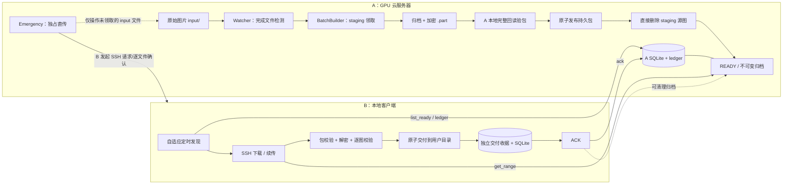
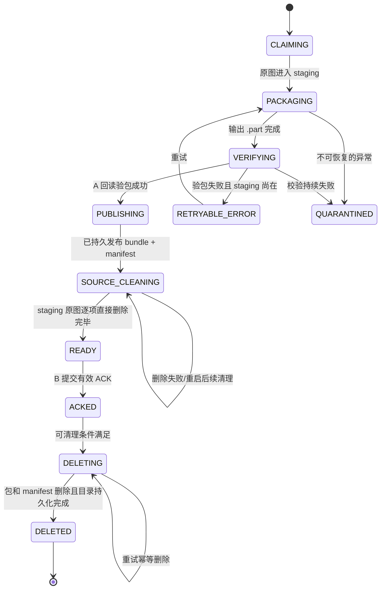

# Adaptive Archive Sync（AAS）开发设计方案 v1.2

> 设计状态：**单 A / 单 B / SSH 后端的核心架构可冻结**（满足本文件的前提与验收测试后）。  
> 修订基础：用户确认的四项选择 + `Adaptive_Archive_Sync_v1.1.md` + v1.1 设计评审清单。  
> 目标平台：A = Linux GPU 云服务器；B = Windows/Linux 本地电脑。  
> 版本日期：2026-10-22。  
> **优先级规则**：本文与 v1.1 冲突时，以本文为准。原 v1.1 可作为历史方案、实验设计细节的参考，不能与本文混用已废弃的状态语义。

---

## 0. 结论与已经确定的用户决策

| ID | 已确认决策 | v1.2 落地结果 |
|---|---|---|
| U1 | A 打包完成后自己验证完整性，验证成功才放入归档就绪目录，然后删除原图 | **先完整回读验包 → 持久发布归档 → 从 staging 直接 unlink 源图 → 标记 READY**；不等 B 的 ACK 才删除源图 |
| U2 | 容灾范围只涵盖普通进程重启、网络中断和可恢复软件错误 | 不保证云实例销毁、A 的整盘损坏、存储服务故障后还能恢复 |
| U3 | B 不托管交付后的图片，用户可以随时移动、修改、删除 | B 只证明**交付时**正确；交付收据单独放在 B 内部状态目录；不因图片后续变化撤销 ACK |
| U4 | 正常情况下不主动暂停生成器；用参数控制生产与传输；提供应急逐图通道 | 不设计自动干预生成器的复杂背压控制；保留容量告警及人工调用的**应急单文件流式传输** |
| U5 | 正常流程涉及的两类删除必须可靠，并且不放进回收站 | A 的源图删除与 A 的归档包删除均采用**持久化状态 + 前置验证 + 精确路径 + 原生文件系统删除 + 崩溃续清理** |
| U6 | B 以压缩包数/小时为初始先验，按观测自适应调整拉取时间 | **自适应定时轮询是默认模式**；固定轮询为降级/基线；长轮询为可选模式 |

### 核心范围

- **正常通道**：A 监控、分批打包、验包、发布、删除源图；B 定时拉取全部就绪包、校验、解密/解包、交付、记录收据、ACK；A 收到有效 ACK 后清理对应归档包。
- **应急通道**：B 手动请求；A 暂停普通文件领取，直接逐张向 B 流式发送已完成的原图；每张由 B 确认接收后 A 立即删除该源文件。**不创建 tar 包，也不纳入正常批次 ACK/账本保证**。
- **非目标**：保证云主机损坏后的数据可恢复；管理已交付用户图片；用加密规避云平台审查；自行设计密码算法；发布公网 Web 管理端。

---

## 1. 必须承认的技术边界

1. **“发布归档”和“删除许多源文件”不可能是同一个跨 SQLite/文件系统的原子事务。** 本项目通过先发布可回读的持久包、再分步直接删除源文件、最后公开 READY 的恢复协议，提供*可恢复的等效顺序*，而不是宣称瞬时同时删除。
2. **只有一份归档且已删原图时，不存在无条件的零丢失保证。** 在用户选择的 U2 范围内，假设 A 存储卷没有不可恢复的物理损坏、归档未遭外部篡改且密钥可用；若之后整盘损坏，无法从无副本状态恢复。
3. **B 交付完成后，输出图片的现存状态不再属于 AAS 的保证范围。** 不得把后续用户删除图片解释为传输失败；也不得声称始终存在“最终一份副本”。
4. **软件删除≠物理不可恢复擦除。** `unlink` / 文件系统原生删除不进入回收站，但 SSD、写时复制、快照、提供商备份及存储层残留可能仍存在；本项目不承诺物理安全擦除或绕过平台监测。
5. **持续生产 + B 无限离线 + A 有限磁盘**无法通过调参获得数学意义上的永久稳定。用户接受容量风险，但需要告警与明确的磁盘不足错误，不允许为腾空间而擅自清理尚未 ACK 的正常归档。

---

## 2. 系统架构与边界



- **主连接方向**：始终由 B 主动建立 SSH 到 A；A 不要求连接家庭网络的 B。
- **模块边界**：`BatchBuilder / VerifyGate / Delivery / ReceiptLedger` 是业务模块；`Transport / CryptoStrategy / ArchiveStrategy / PollPolicy` 是可替换策略。策略不能直接修改对方状态机。
- **支持范围**：MVP = 单一生产者、单一消费者、单 SSH 控制后端；字段预留 producer/consumer ID，但**不承诺**无需重设计便可支持多消费者或对象存储。
- **权限**：A 以非 root 专用账户运行，SSH 用受限 `aasctl-shell`；远端参数采用 ID，禁止传任意文件路径或 shell 命令。

---

## 3. 目录与元数据

### 3.1 A 目录

```text
/workspace/aas/
├── input/                  # 可在配置中指向生成器输出目录
├── staging/<batch_id>/     # 原图：打包过程中安全保留，验包发布后才删除
├── building/<batch_id>/    # bundle.part + manifest.part，构建中不可见
├── ready/<batch_id>/       # bundle + manifest；只读、不可变
├── quarantine/            # 有故障时保留证据，不自动删除
├── state/aas_a.sqlite3
└── logs/
```

`building/` 与 `ready/` **必须同一文件系统**以原子 rename；`staging/` 与源目录最好同一文件系统，不同时需先复制、校验并完成持久化后才取消源目录文件。应急模式只处理 `input/` 中**未被领取**的完整文件。

### 3.2 B 目录

```text
D:/AAS/
├── incoming/               # 已接收的 .part / bundle；内部中间区
├── restoring/<batch_id>/   # 解包、验证的私有暂存区
├── state/
│   ├── aas_b.sqlite3       # 性能索引；可从 receipts 重建
│   └── receipts/<producer_id>/<batch_id>.json
├── quarantine/
└── output/<batch_id>/      # 用户拥有：交付后可移动、编辑、删除
```

- `restoring/` 与 `output/` 必须同一文件系统以支持目录 rename。
- **`state/receipts/` 是 B 的内部交付证明，不放在 output 中**，用户对 output 的任何操作不触发 B 端清理或重新验证。
- 建议 B 定期备份很小的 receipts/ 及配置。用户若主动删除所有交付收据且又删/改了输出目录，则无法自动还原历史交付事实；这属于明确的非保证范围。
- 同一批次的目标路径固定为 `output/<producer_id>/<batch_id>/` 或其配置映射；若与用户已有路径冲突，**禁止覆盖**，暂停此批交付并提示。

---

## 4. A 正常流程：先可靠归档，再删除原图

### 4.1 图片完成判定

优先采用生成器 `name.tmp → fsync → rename(name.png/jpg/webp)` 的完成协议。无法控制生成器时，以 inotify `IN_CLOSE_WRITE`/`IN_MOVED_TO` + 定期目录扫描降级，并辅以多次稳定 size/mtime 与文件格式检测。拒绝软链接、目录逃逸、特殊设备、未完成文件。生成器文件**不能在领取后继续写入**；能配合生成器写入完成协议时应强制启用。

### 4.2 归档批次状态



**`READY` 的严格含义**：

- 归档**已从最终文件回读**成功、逐图内容与领取时清单一致；
- 归档和 manifest 均持久写入 `ready/<batch_id>/` 且文件不可变；
- staging 对应原图已经按清单执行直接删除并完成状态对账；
- A 的 SQLite 事务将 `state=READY` 与新的 `ready_event_id` 一同提交；B 只能看见 `READY`。

若在 SOURCE_CLEANING 中崩溃，A 启动后核对已验证、已发布的包，再继续删除剩余 staging 源图，最后提交 READY。**不得“失败后返回 input 重打包”导致已有发布包与源图被二次入批。**

### 4.3 验包门槛（VerifyGate）

用户要求 A 自己保证归档完整，必须执行两组验证，而不是只计算刚写出的密文 SHA-256。

1. **源快照**：领取时记录每张完整图片的路径、稳定的 item ID、原始字节数、SHA-256；打包过程中不得修改。
2. **完整归档回读**：对 `building/<id>/bundle.part` 从磁盘重新读取；校验密文长度与 SHA-256；若加密则**解密回读整个归档**；检查 tar 结构、成员路径、成员数量、逐图大小及 SHA-256，必须与源快照逐项一致；读取、解密、归档解析、子进程退出码任何一步失败均不准发布。
3. **成功门槛**：校验报告 `verification.json` 与 manifest（或 DB 审核记录）同步落盘；`fsync` 正式 payload、manifest、构建目录；将整个批次目录原子 rename 到 `ready/<id>`，`fsync` 其父目录。
4. **再删除源图**：从本批 `staging/<id>` 中按清单使用 `unlink` 删除，每次核对文件身份和根目录界限；清理剩余空目录；根据操作系统能力同步相关目录并记录删除游标；全部完成后设置 READY。
5. **绝不反转顺序**：不能因为 `.part` 存在、打包进程退出 0、长度匹配、hash 已计算就提前清理原图。

#### age 加密下 A 如何“验包后删原图”

v1.1 采用 `age_x25519` 时 A 只有 B 的公钥，因此**仅凭 B 的公钥无法解开加密后的包，自然也无法直接进行最终密文→解密→逐图完整性回读**。v1.2 统一在 `CryptoStrategy.audit_roundtrip()` 中解决：

- 正常加密时加入 **仅本次构建有效的 A 侧临时审核收件人公钥**，连同 B 主公钥、B 离线备份公钥一起加密。
- 验包时 A 用临时审核私钥**回读最终密文**，验证 tar 与逐图 SHA-256；完成后不再保留该私钥，归档不依赖它进行后续交付。
- **不能宣称审核私钥在云端内存中曾出现就能够做到物理不可恢复擦除。** 此机制只是用来满足 A 侧完整性测试，并不用于绕过服务器内容访问或平台审核。
- B 仍通过它自己的主/备私钥解密；A 的一次性审核并不能证明 B 的私钥一定正确，因此 B 在最终交付时仍必须独立解密、验证。
- `none` 策略直接回读并验证 tar；自定义加密策略若不支持可靠 `audit_roundtrip()`，不得启用“校验后自动删除源图”的正常流程。

> 可通过同等强度且可验证的其他审核机制实现，而不强制某种私钥生命周期；验收条件是**最终生成的可交付 bundle 被 A 真正回读验证**，而非内部生成器自报成功。

### 4.4 正常删除流程一：源图

执行点：**完成持久发布且通过完整回读验证后，尚未置 READY 前**。

- 只删除本批 `staging/<batch_id>/` 中记录的源文件，禁止按通配符扫描生成目录删除，也不删除非本批的新图。
- 每张删除前确认属于已验证批次；删除使用 `os.unlink` / 目录删除使用 `os.rmdir`，**不使用回收站 API**。
- 文件已不存在按幂等完成处理，但必须结合领取清单和归档验证记录，不能随意把未知缺失视为安全。
- 删除失败或崩溃，保持 `SOURCE_CLEANING`，重启后核对包与清单，再重试；不能伪造 READY。
- 新生成同名图片不会被误删：删除目标只能是有专属 ID 的 staging 文件句柄/路径，绝不能重新按 `input/<filename>` 删除。
- 正常情况下尽快执行，不增加人为的原图保留期；遇到 I/O 异常必须告警和停留，不能牺牲可靠性来赶进度。

---

## 5. B 正常流程：验证后交付，但不接管用户图片

### 5.1 拉取和完整性验证

1. B 查询所有 `READY`（分页，不依赖仅查询最新 seq），拿到 manifest 与 `ready_event_id`。
2. B 对每个包按固定 `batch_id + sha256 + size` 进行断点续传，接到 `incoming/*.part`。
3. 完成后严格核对 `payload_bytes` 与密文 `payload_sha256`，不一致不得改名/解密。
4. 解密并安全解包到私有 `restoring/<id>`，拒绝绝对路径、`..`、硬/软链接、大小写碰撞、Windows 保留名等。
5. 校验解密后 tar SHA-256、逐张图片的大小和 SHA-256、图片数、源字节总数；任一失败**不得 ACK**。
6. 用固定的临时/最终目录命名，控制并发、单次下载与解包空间；失败保留可诊断记录而不是覆盖用户文件。

### 5.2 交付语义：handoff，不是图片托管

**交付点**：B 已验证完所有图片，并通过原子 rename 使本批文件在指定用户输出路径中可见。此后用户获得完全处置权。

交付收据必须与用户文件目录分离；收据包含 `producer_id, batch_id, seq, payload_sha256, files_index_sha256, file_count, committed_bytes, target_path, delivered_at, receipt_status`。`committed_bytes` 定义为**解包图片原始字节总和**，不等于压缩包字节数。

正常交付步骤：

1. staging 文件全部写入并按能力 `fsync`；写 `state/receipts/<id>.PREPARED` 并持久化；确保目标位置尚无同名正式批次。
2. 原子 `rename(restoring/<id>, output/<producer_id>/<id>)`；记录 B 本地日志。
3. **将独立 receipt 持久化为 `DELIVERED`**，并更新 B SQLite 索引。`DELIVERED` 是 B 发出 ACK 的必要条件；用户输出目录不再用作 ACK 的事实来源。
4. B 发送带 batch 身份、哈希与文件统计的 ACK，获得 `accepted/already_acked` 才把传输任务视为闭环。
5. **ACK 后以及 DELIVERED 后**，B 不执行用户图片的自动扫描、移走、删除、覆盖或“找不到就重新下载”；这些是用户后续自主操作，不构成 B 传输失败。

#### 交付窗口崩溃（不可回避的边界）

`rename` 与 B 的独立 receipt 写入不可能跨文件系统和数据库原子完成，因此：

- 如果恢复时已有 `DELIVERED` 收据，无论用户图像是否存在/已改动，都可幂等补发 ACK。
- 如果仅有 `PREPARED` 且目标目录仍在：B 仅在**恢复这次未完成交付时**检查它是否与已验证快照一致；一致则补成 `DELIVERED`；失败则进入 `HANDOFF_UNCERTAIN`。
- 如果仅有 `PREPARED`，但用户可能已将刚公开的输出移动/删除：不能据此认定“未交付”；**暂停自动 ACK，也不自动重新下载到新目录造成重复**，发出需要人工裁决的状态。
- 这是 U3 用户自由处置与跨状态存储无法原子提交的必然取舍；只在极短的未确认窗口需要恢复检查，不形成对日常用户图库的持续管理。

### 5.3 收据与状态恢复

- **B 的 SQLite 只是派生索引**；B 启动时可从 `state/receipts/*.json` 重建已交付集合，即使用户把 `output/` 删空也不应出现“丢批”误判。
- `DELIVERED` 收据一经生成不得自动回滚；B 对账时按交付事件比较 A 账本，而非扫描用户当前图库。
- 用户可移动、删除、改名或编辑任何已交付文件；AAS 不会恢复用户主动改动，也不会把其计入系统完整性故障。
- B 若主动丢失收据和 SQLite，且用户也修改/删除输出，则无法自动证明历史接收成功；这种人为状态同时丢失不在 U2 的保障范围内。

---

## 6. ACK 与正常删除流程二：归档包

### 6.1 ACK 必须满足的条件

`ACK` 表示：**B 已完整下载、解密（如适用）、校验逐图、完成一次成功用户目录交付，且本地 `DELIVERED` 收据持久化。**

请求示例：

```json
{
  "producer_id": "gpu-a-01",
  "consumer_id": "desktop-b-01",
  "batch_id": "20261022T080100Z-0a91dc42",
  "seq": 125,
  "payload_sha256": "<64 hex>",
  "file_count": 100,
  "committed_bytes": 601002345,
  "receipt_version": 1
}
```

- A 只接受 SSH 认证且授权的 B；按 DB/manifest **逐字段校验 `producer_id, consumer_id, batch_id, seq, payload_sha256, file_count, committed_bytes`**。
- 同一批重复 ACK 返回 `already_acked` 或 `already_deleted`，B 视为成功；哈希不符、批次未知、权限不符均拒绝。
- `ACK` 记录应作为独立持久事件先在 A SQLite 中提交，**然后**才允许删除归档文件；网络响应丢失时 B 可重发。
- ACK 表示曾成功交付，不表示 B 用户目录中的图片目前依然存在；A 不尝试远程检查 B 的输出目录。

### 6.2 A 归档清理（默认收到有效 ACK 后尽快清理）

默认 `ack_grace_seconds: 0`，即 ACK 被持久接受后由 A 的清理 worker 尽快清理。可选设置正数宽限期，但**不是交付正确性的前提**。

1. `READY → ACKED`：记录 ACK 身份、收到时间、回执信息和唯一清理资格。
2. `ACKED → DELETING`：事务 CAS 获得清理所有权；拒绝未 ACK、哈希不符或 QUARANTINED 批次的清理请求。
3. 用固定 batch ID 定位 `ready/<batch_id>/`，不接受远端提供任意路径；再次核对目标为归档库中的本批对象。
4. 对 `bundle` 与 `manifest` 使用 `unlink`，清理空批次目录，按操作系统能力 `fsync` 父目录；不进入回收站。
5. `DELETING → DELETED`：文件系统动作完成后写 DB/ledger，**保留小型删除墓碑和 ACK 记录**，不再保留归档大文件。
6. 在任何中间步骤崩溃，恢复 worker 依据 DB 和固定路径继续幂等清理；“文件已不存在”在有匹配删除账本时视为完成，否则告警调查。

**永久约束**：未经 B 的有效 ACK，正常清理 worker 不得删除 READY 包；文件创建超过 N 天也不能构成越权清理理由。`reopen` 仅当 ACKED 仍有包且尚未进入 DELETING 时可用；默认零宽限意味着其恢复窗口极短，不许把 `reopen` 当主要容灾保证。

---

## 7. 应急模式：逐图传输、逐图删除，独立于正常状态机

### 7.1 触发与权限

- **手动/显式触发**：B 执行 `aas-b emergency --from-input`；自动容量告警可以提示，但不自动切换为不可靠的应急模式。
- B 启动一个**由 B 发起的 SSH 会话**，请求 A 运行受限 `aasctl emergency-stream`；A 在这条会话中主动逐图向 B 输出数据，因此无需 B 的公网 IP 或 A 反连。
- A 取得 `input_claim_lock`，与正常 BatchBuilder 对 `input/` 的领取**互斥**。已在 staging 的正常批次不参与应急；新生产图片须确认已完成写入。
- 会话结束/崩溃释放锁，正常 watcher 继续；加入排他锁超时与进程异常释放，避免永久卡住生产。

### 7.2 极简流式协议

```text
B: ssh exec "aasctl emergency-stream"
A: HEADER {file_token, relative_path, bytes} + BINARY_FILE
B: 保存本地临时文件 → 关闭/刷新 → 发 OK(file_token) 到 SSH stdin
A: 验证 token 对应当前已经发送的文件 → unlink(input/<具体已领取文件>)
A: HEADER(next file) ... 直至 END
```

- 使用**长度帧协议**区分 JSON 头与二进制文件，日志只发到 stderr；不要逐字节把大图编码成 JSON/base64。
- 应急文件可从 input 中临时移动到 `emergency_claim/` 以固定身份，避免与新生成同名文件冲突；如果使用此目录，应确保与 input 同卷且进程崩溃后能归还未确认文件。
- B 仅对完整接收的单文件发 `OK(token)`；A 收到后立刻使用 `unlink` 删除该文件，不进入回收站。
- **不生成 tar/加密包、不生成正常 seq、不发送正常批次 ACK、不对账到正常账本**；只做必要的文件名/类型/路径安全校验。
- 不承诺断电断网时严格无丢失、无重复、跨会话恢复、密文归档重建；这与用户指定“应急处理简单、风险可接受”的约束一致。
- 若需要更高保证，必须改走正常归档管线，**不能在应急模式中偷偷复用正常的‘零丢失’承诺**。

### 7.3 应急不能破坏正常可靠性

- 排他锁保证同一源图不会被正常批次和应急会话**同时领取**。
- 应急不会删除 `staging/`、`ready/`、任何已经有正常 batch ID 的文件。
- 应急操作不会把正常批次状态推进 ACKED/DELETED，也不会跳过 B 的正常包校验。
- A 对应急会话分配专用受限权限，不开放任意文件读取或删除能力。

---

## 8. 默认 B 自适应轮询调度

### 8.1 输入、目标和输出

- 用户全局参数 `expected_archives_per_hour = r0 > 0`；初始预计包间隔 `P0 = 3600 / r0` 秒。
- B 每次成功查询记录 `server_time`、自上次成功观测以来新增的 DATA READY 事件数、事件的 A 时间戳；**无包也是一个“计数为 0、观察时间继续增加”的有效暴露量**。连接失败不是“无包”。
- 维护一个带时间衰减的到达率估计（例如 Gamma–Poisson 的伪计数/暴露时长，或稳定生产时更新过程的间隔 EWMA）；**禁止直接使用 EWMA(1/到达间隔)**。
- 下一次轮询时长 `T = clamp(poll_factor * 3600 / r_hat, min_poll, max_poll)`；若配置发现延迟 SLO，再将 `T` 截断为不高于 SLO 所允许的上限。
- 目标是用有限请求代价换取可接受的发现时延，**并非保证每次 SSH 只拿到一个包**；真实积压时应立即取全量。

### 8.2 一次循环

```text
启动：读取最近观测与先验 r0 → SSH hello → list_ready(all pages) + ledger 对账
发现 M 个 READY：登记全部批次 → 按 seq 调度下载 M 个（受并发上限）
  └─ 一轮结束后立即再查询一次，追赶传输期间新来的包
没有 READY：记录成功空观测，更新到达率估计 → 计算下一次轮询时间
网络失败：只更新网络重试退避，不把失败样本计入到达率
随时：每隔 reconcile_interval 执行完整 READY/ledger 对账
```

- **到达预测**与**传输耗时预测**是两条独立链路；传输耗时用近期实测速率/分位数估算 ETA，不能用来伪造生产到达时间。
- 默认只用简单在线统计，无需无监督神经网络。复杂预测器可以作为替换 `PollPolicy` 的实验插件，需要在真实非平稳工作负载上赢过固定周期才启用。
- 可选 `long_poll`，但**不能把其设为默认替代用户的自适应轮询要求**。

### 8.3 READY 发现游标与重开事件

- `seq` = 批次身份、长期账本序号，不因重试或 reopen 改变。
- `ready_event_id` = 每次进入 READY 时分配的单调事件序号，含恢复性发布与 reopen；不得用 `seq > cursor` 唯一检测新 READY。
- `list_ready` 必须支持全量分页或 `after_event_id` 增量发现；B 定期全量对账，保证重开旧批次、跨页积压不会被游标跳过。
- `ledger` 专门负责 `seq → batch_id → 状态` 的审计，不作为唯一实时发现机制。

---

## 9. 加密与策略模式

### 9.1 统一接口

```python
class CryptoStrategy(Protocol):
    scheme: str
    version: int

    def validate_config(self, config) -> None: ...
    def selftest(self) -> None: ...
    def encrypt_stream(self, source, sink, context) -> dict: ...
    def decrypt_stream(self, source, sink, metadata, context) -> None: ...
    def audit_roundtrip(self, final_bundle_path, source_snapshot, metadata, context) -> VerificationReport: ...
```

- 默认注册 `none` 和 `age_x25519`，后续可添加已审查的自定义插件；策略注册表与外部业务状态机分离。
- **能完成 audit_roundtrip 是 A 在 READY 前自动删除源图的强制能力**。自定义策略只能通过接口改变加解密方式，不可绕过 VerifyGate、删除条件或 ACK 状态机。
- 私钥与口令只进入策略内部/受限凭据存储；manifest 中仅公开方案标识、版本、无秘密参数、密文哈希等。
- **不能使用公开的 SHA-256 或由它单独推导的公开密码作为保密方案**。哈希负责一致性；密钥必须有独立的秘密熵。
- 加密不构成防止云提供商接触原图的保证；A 打包前始终接触明文。

### 9.2 密钥与 B 端测试

- 正常 age 加密至少以 B 主公钥为收件人；建议加入 B 离线备份公钥以免 B 单一私钥丢失。
- A 的临时审核收件人仅用于**本次最终密文自检**，审核后不作为 B 恢复手段。
- B 第一次连接、密钥更换或自检失败后，可使用 `crypto-probe` 请求 A 产生即时挑战密文，在 B 本地解密验证；不要硬性依赖“每次开机都有一份尚未删除的 canary 包”。
- B 对每个真实批次仍逐次解密与哈希验证；挑战成功不能取代实际数据校验。

---

## 10. SSH 协议面与访问控制

默认只开放受限 `aasctl-shell`，由 B 以 SSH 命令执行；连接账户无 shell 通用执行权限。所有传输接口以 ID/令牌索引对象，不收任意远端路径。

| 指令/接口 | 用途 | 权限 |
|---|---|---|
| `hello` | 版本、能力、producer_id、时间 | 只读 |
| `list-ready [--cursor X] [--page-size N]` | 全部/增量 READY 目录 | 只读 |
| `info --batch-id ID` | 获取 manifest | 只读 |
| `get --batch-id ID --offset O --length L` | 标准输出流式读取不可变 payload | 只读 |
| `ack --batch-id ID --...` | 验证 B 的交付回执并写持久 ACK | B 授权写 |
| `ledger --since-seq N` | 状态审计与补漏 | 只读 |
| `crypto-probe` | 按需测试 B 的加密接收能力 | 限流 |
| `emergency-stream` | B 主动申请的单会话原图逐项交付 | 独立授权/全局排他 |
| `status` | 基础容量/健康状态 | 只读 |
| `pause/resume/doctor` | 运维 | 本机管理员密钥专用 |

- `StrictHostKeyChecking=yes`，绑定预期主机密钥；云实例重建后不能简单自动忽略新主机指纹。
- 用 `producer_id, batch_id, consumer_id` 明确身份绑定；B 不能要求删除某个路径，只有 A 根据有效 ACK 派生可删除的批次对象。
- 日志仅 stderr；stdout 严格二进制流与规定的帧，避免图片流混入日志导致损坏。

---

## 11. 正确性不变量（重新定义 v1.1 的 I1～I7）

| ID | 必须始终成立的事实 |
|---|---|
| N1 | A 某源图被**正常通道**删除 ⇒ 对应批次的**最终可交付包**已被 A 完整回读验证且持久发布；该源图在领取清单中 |
| N2 | A 向 B 报 READY ⇒ 本批所有源图完成可靠的 staging 删除；不可变 bundle 与 manifest 完整存在 |
| N3 | A 正常归档包被删除 ⇒ A 账本已持久记录来自授权 B 的匹配 ACK，ACK 只可由成功交付收据触发 |
| N4 | B 发送 ACK ⇒ 下载、解密、解包和逐图校验均成功，用户目录已完成一次成功交付，独立 `DELIVERED` 收据持久化 |
| N5 | B 的 `DELIVERED` 收据不会因用户修改/删除 output 下的图片而失效；AAS 不负责保持用户目录不可变 |
| N6 | 同一文件不会同时被 A 正常 BatchBuilder 和应急流式通道领取 |
| N7 | `seq` 唯一且账本可对账；READY 事件通过独立 `ready_event_id` 发现；重开旧包不会遗漏 |
| N8 | 所有正常删除调用只接受由可信批次身份解析的专属路径；不使用回收站，不做来源于客户端的任意路径删除 |
| N9 | A/B 崩溃后可按本地持久状态重启、续传、续删除；前提是数据所在卷可用且尚未被外部非法修改 |
| N10 | 整机/整卷毁损、用户删除交付收据并删除输出、应急模式中断不在零丢失承诺范围 |

**重要的语义替换**：v1.1 的 `A.DELETED ⇒ B 输出目录当前仍有 COMMITTED 图片` 和“生成器所有图片在 B 最终目录中永久恰好出现一次”，都不再正确；正确表述是**已经发生过一次校验通过的交付事件**，且普通路径的删除顺序符合 N1–N4。

---

## 12. 故障恢复与对账

### 12.1 A 侧

| 崩溃位置 | 处理 |
|---|---|
| 领取到 staging 途中 | 清单对账后继续搬运或回滚，**不删除**未归档源图 |
| 打包/加密中途 | 丢弃 building 部分产物，保留 staging，重新构建 |
| 验包过程中 | 保留 staging；对 building 重验或重建；不得清理源图 |
| 验包成功、ready rename 前 | 按已知清单重复校验或恢复发布 |
| ready rename 后、源图删完前 | 核验已发布 bundle，然后续删 staging，最后进入 READY |
| 删除源图后、DB READY 之前 | 依据已发布 bundle 和删除账本补记 READY；不可重新认领同一源图 |
| B ACK 后、回应之前 | B 重发，A 返回 already_acked |
| A 包删除一部分、DB 尚未 DELETED | 清理 worker 继续 unlink 缺失部分、删除目录、完成账本，不重复 ACK |

### 12.2 B 侧

| 崩溃位置 | 处理 |
|---|---|
| 下载中 | 同一不可变 bundle 的 offset 续传并最终复算整包 SHA-256 |
| 下载完成但校验前 | 复算全部校验，不依赖旧的中间状态 |
| 私有目录解包/验证中 | 丢弃不可信临时解包，重新解密并校验 |
| 收据 PREPARED，输出 rename 前 | 若输出不存在且私有 staging 完好则继续交付 |
| 输出 rename 后、收据 DELIVERED 前 | 尝试一次恢复性核验；若输出已被用户改变/移走则 `HANDOFF_UNCERTAIN` 并提示人工处理 |
| 收据 DELIVERED 后、ACK 前 | 不检查用户当前图片，直接幂等发 ACK |
| ACK 发出、响应丢失 | 幂等重发同一 ACK |
| B SQLite 丢失 | 由内部独立 `receipts/` 重建已交付记录，不扫描已交付用户图库 |

### 12.3 对账重点

- `ledger` 发现 seq 空洞、未交付 READY、ACK 与 B receipt 不匹配、VOID/QUARANTINED 状态。
- 当前 B output 缺图片**不计入传输对账异常**，除非这批仍卡在未确定的 PREPARED → DELIVERED 恢复窗口。
- 归档损坏而源图已删：A 标记 `UNRECOVERABLE` 并告警，不凭空重造原图；这属于用户接受的单副本故障边界，不能谎称自动恢复。

---

## 13. 容量、性能与调度约束

- A 基础指标：`input_bytes, staging_bytes, building_bytes, ready_bytes, acked_bytes, free_bytes, estimated_time_to_full`；B 指标：`incoming_bytes, restoring_bytes, output_free_bytes, download_rate, delivered_rate`。
- A 遇到临界磁盘空间时**先明确报错/告警，停止新的不安全打包**；**不自动暂停生成器**，也不自动删除未 ACK 的归档。用户可主动运行应急通道。
- 由于打包后源图才被删除，构建过程中至少要容纳原图 staging + 一份 bundle（含流式加密开销）；同时计入 B 尚未确认的 ready 包。容量预留参数不能只按平均图片数计算，必须按**最大批次尺寸和 B 最大允许离线时长**估算。
- A 归档默认 **tar**，图片已经压缩时通常没必要再启用重压缩；可用 `tar.zst` 插件实测。无论归档格式，必须支持全量最终包回读验证。
- B 可配置 `max_parallel_downloads` 与网络/磁盘预算；积压时拉取全部**待处理队列**，不是要求同一瞬间开启无限并发任务。
- SSH 流式传输可按 `get_range` 恢复；任何 `get` 客户端收到少于 manifest 指定的字节数都不算成功。

---

## 14. 关键配置示例

### 14.1 A

```yaml
node:
  producer_id: gpu-a-01
paths:
  input_dir: /workspace/generated
  staging_dir: /workspace/aas/staging
  building_dir: /workspace/aas/building
  ready_dir: /workspace/aas/ready
  state_db: /workspace/aas/state/aas_a.sqlite3
batch:
  max_files: 100
  max_bytes: 1073741824
  max_wait_seconds: 600
  max_batch_bytes: 4294967296
archive:
  strategy: tar
  verify_final_archive: true          # 不允许关闭，同时启用删除源图时更不允许
  delete_source_after_verified_publish: true
  source_deletion_mode: unlink        # 原生删除，不进入回收站
crypto:
  strategy: age_x25519
  recipients: [b_primary.pub, b_backup.pub]
  audit_roundtrip_required: true
ack:
  delete_bundle_only_after_ack: true
  ack_grace_seconds: 0                # 默认尽快删除；可设置非零宽限
  ledger_retention: forever
emergency:
  enabled: true
  manual_only: true
  normal_claim_exclusive: true
  per_file_ack: true
capacity:
  warn_free_bytes: 21474836480
  critical_free_bytes: 10737418240
  auto_pause_generator: false
  auto_delete_unacked: false
```

### 14.2 B

```yaml
node:
  consumer_id: desktop-b-01
remote:
  transport: ssh_aasctl
  host: gpu.example.com
  port: 22
  host_key_checking: strict
paths:
  incoming_dir: D:/AAS/incoming
  restoring_dir: D:/AAS/restoring
  output_dir: D:/AAS/output           # 用户可以自由处置已交付图片
  state_dir: D:/AAS/state             # AAS 内部收据，不可当作图库
scheduler:
  mode: adaptive                      # adaptive | fixed | long_poll
  expected_archives_per_hour: 6.0
  poll_factor: 1.0
  min_poll_seconds: 15
  max_poll_seconds: 600
  discovery_slo_p95_seconds: 300
  reconcile_interval_minutes: 30
  backlog_immediate_recheck: true
transfer:
  max_parallel_downloads: 2
  require_full_bundle_sha256: true
  allow_resume: true
delivery:
  verify_each_file_sha256: true
  record_receipt_outside_output: true
  allow_user_modification_after_handoff: true
  never_manage_delivered_output: true
emergency:
  allow_manual_request: true
  require_simple_file_ack: true
```

---

## 15. 项目模块与实施里程碑

```text
adaptive-archive-sync/
├── docs/ARCHITECTURE.md PROTOCOL.md SECURITY.md OPERATIONS.md TEST_PLAN.md
├── config/a.example.yaml b.example.yaml
├── src/aas/
│   ├── common/       models.py ids.py filesystem.py checksum.py manifest.py config.py
│   ├── a/            watcher.py claim.py batch.py verify_gate.py publisher.py
│   │                 source_cleaner.py bundle_cleaner.py state_db.py recovery.py
│   │                 ssh_ctl.py emergency_stream.py capacity.py
│   ├── b/            adaptive_poll.py discovery.py downloader.py validator.py
│   │                 handoff.py receipts.py acknowledger.py reconcile.py
│   │                 emergency_client.py recovery.py
│   ├── crypto/       base.py registry.py none.py age_x25519.py
│   ├── archive/      base.py tar.py tar_zst.py
│   └── transport/    base.py ssh_aasctl.py
├── tests/            unit/ integration/ fault_injection/ property/ benchmark/
└── scripts/          install_a.sh install_b.ps1 doctor.py
```

| 阶段 | 范围 | 硬性退出条件 |
|---|---|---|
| M0 | 协议、受限 SSH 接口、DB 状态机、模拟文件与 failpoint | 用虚拟目录建立并对账 seq/event/manifest |
| M1 | A 领取、流式归档、VerifyGate、持久发布、源图可靠删除 | A 在校验失败时绝不删图；在不同删除中断点可恢复 |
| M2 | B 下载、校验、解包、交付收据、ACK、A 包清理 | 正常双删除流程都满足 N1–N4、N8–N9；B 输出可修改而不影响 ACK |
| M3 | 自适应定时调度、空观测统计、积压拉尽、全量对账 | 无包/突发/非平稳/断网条件下不会漏 READY；SLO 与请求次数可记录 |
| M4 | 加密策略切换、age 完整回读验证、B 密钥挑战 | 切换加密不修改业务层；错误密钥不 ACK，A 审核失败不删源图 |
| M5 | 手动应急流、独占锁、逐文件 ACK/删除 | 并发正常/应急时一图只被一条通道领取；应急不污染正常账本 |
| M6 | Windows/Linux 兼容、端到端故障注入、部署、72h soak | 所有正常不变量持续通过；记录非保证故障边界 |

**开发建议**：首先实现最短主链路（小批次原图 → A 读回校验 → 删源图 → B 下载/解包/交付 → 交付收据 → ACK → A 删除包），再实现优化与插件。测试框架尽早插入，但不要将对象存储、多消费者等范围扩张加入 MVP。

---

## 16. 必测用例与可靠删除验收

### 16.1 正常删除一：A 源图

- [ ] 验包失败（tar 截断、age 错误、逐图 SHA 不匹配）时，**0 张源图被删**。
- [ ] 打包退出码为 0 但读回验包失败时，仍**0 张源图被删**。
- [ ] 成功发布 bundle 后，在删第 1 张、第 N/2 张和最后 1 张附近 `kill -9`；恢复后源图清理完成且**每张最多属于一个发布批次**。
- [ ] 模拟同名新图在 input 出现，不会被旧批清理过程误删。
- [ ] 已成功源图删除用 `unlink`，不使用回收站；只删 staging 里归属本批的源图。
- [ ] READY 状态出现时，源图删除已完成且最终归档的完整回读验证记录存在。

### 16.2 正常删除二：A 归档

- [ ] 未收到有效 ACK、收到假 batch ID、哈希错误、消费端身份不符时，**0 个正常归档被删**。
- [ ] B 下载半包/解压一半、收据只是 PREPARED 时，不触发 ACK 或远端删除。
- [ ] B 的 `DELIVERED` 收据持久存在、ACK 丢失/重复时，最后只清理正确的一份归档。
- [ ] 模拟 A 先删除 bundle、尚未删 manifest 就掉电；恢复后继续清理并写 DELETED。
- [ ] 人为修改/删除 B 交付后的图像，不影响历史收据、ACK 和 A 端可删除判定。
- [ ] 删除使用文件系统原生 unlink，不使用回收站，并保留紧凑清理账本。

### 16.3 双端恢复与用户自由修改

- [ ] B SQLite 丢失、receipts 仍在、output 已被用户删空：重建后依然认定已交付批次成功，不自动重新下载。
- [ ] `PREPARED` 后输出目录被移走且进程崩溃：进入 `HANDOFF_UNCERTAIN`，不误发 ACK，也不自动重新交付造成重复。
- [ ] 对 A 的两个游标分别构造重新发布旧 seq，确认 B 能发现。
- [ ] 断网、重连、半包续传与多包积压测试中，最终收到相应批次完整 ACK。

### 16.4 应急模式

- [ ] B 请求一次应急会话，A 顺序发送每张已完成原图；B 发单文件 OK 后，该文件在 A 端使用 unlink 直接删除。
- [ ] 正常领取与应急独占；同一图不会同时被归档和应急读取/删除。
- [ ] B 不回应 OK 时，A 不按正常删除流程处理该文件；应急风险可保留，不做复杂事务补偿。
- [ ] 应急图片不生成正常 seq、不污染 READY/ACK/DELETED 账本。

### 16.5 业务指标

- 正常流程可靠性主指标：提前删除原图数 = 0；无有效 ACK 清理归档数 = 0；用户输出冲突覆盖数 = 0；跨通道重复领取数 = 0。
- 完整性：交付时逐图 SHA 不一致数 = 0；经 B 验证却未形成 durable receipt 就 ACK 的次数 = 0。
- 调度：记录成功空查询次数、SSH 尝试与失败次数、READY→首次发现时延 P50/P95、积压峰值、下载与解包速率；明确“用户之后修改输出”不算数据损坏。

---

## 17. 仍属实现细节而非新设计决策的事项

| 类别 | 默认处理 |
|---|---|
| 文件完成通知 | 优先 `.tmp → rename`，次选 inotify + 稳定性检查 |
| 归档格式 | tar，不压缩；zstd 可选实测 |
| 单批阈值 | 100 张或 1 GiB 或最长等待 600 s（任一触发） |
| B 并行度 | 2，按测得吞吐与磁盘资源调整 |
| 轮询初始先验 | 6 包/小时，动态学习后更新；空轮询计为有效零计数观测 |
| 异常重试 | 限速指数退避 + 抖动；不修改 READY 不可变内容 |
| 状态存储 | SQLite WAL + 同步写；账本长期保留，状态库需要可用磁盘 |
| Windows 文件规则 | 不覆盖同名批次；大小写冲突、保留名、超长路径、rename 占用按启动自检和失败分类处理 |
| 密钥 | B 主密钥 + 离线备份密钥；不使用公开哈希做密码 |
| SSH 失败 | 网络重试独立记账；认证失败进入人工处理，不误以为没有新包 |
| 应急启动 | 用户手动触发，不自动占用 normal 可靠性通道 |
| 回收站 | 不调用任何回收站/Trash API；A 使用 unlink，B 自有临时文件亦用系统删除 |

## 18. 最终设计判断

1. **已不需要再向用户征询新的大方向设计选择。** 用户要求的四项边界均已纳入；单 A / 单 B / SSH 主链路可以进入代码开发。
2. 必须优先通过 **VerifyGate、B 独立交付收据、ACK CAS、正常双删除、应急排他锁** 的端到端测试。不能仅凭模块存在就认为可靠性目标达成。
3. 应急模式是**主动接受更弱故障保证**的独立模式，不得与正常可靠交付目标混淆。
4. 若将来改变下列任一条件——需要云实例销毁后恢复、B 用户文件永远不可丢、多用户同时拉取、无需人为裁决的跨系统严格 exactly-once——则需要重新评估架构，而不是只改配置。
